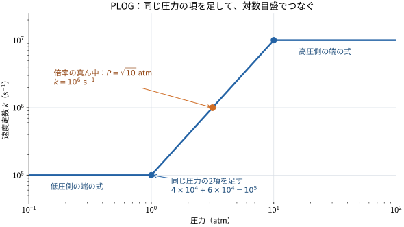

# SpeedCHEMの中で何が起きているか

SpeedCHEMに渡すのは「今の温度と組成」。返ってくるのは「少し時間が進んだあとの温度と組成」です。
その間に反応がどれだけ進むかを、反応機構に沿って計算しています。

ここでは、ODEやPLOGの名前は聞いたことがあるけど、中身を一から追うのはしんどい、というくらいを想定します。
まずは本文だけで大丈夫です。式の細部は折りたたみに、導出や実装との対応は[英語の詳しい版](theory.md)にあります。
PLOGだけ見たいなら、[圧力ごとの速度定数の話](#plogは圧力ごとの速度定数をつなぐ)へどうぞ。

## 温度と組成を、まとめて時間で進める

たとえば、水素と酸素の混合気を考えます。
反応が進むと、水素と酸素が減って水が増え、途中ではラジカルも出たり消えたりします。発熱すれば温度も上がります。
温度が上がると反応速度が変わるので、組成と温度は一緒に計算する必要があります。

SpeedCHEMが持つ状態は、温度 $T$ と、各化学種の質量分率 $Y_i$ です。
質量分率は「混合気の質量のうち、その化学種が占める割合」。$Y_i=0.2$ なら20%です。

コードに渡す配列は、こんな並びです。

```text
[温度, 化学種1の質量分率, 化学種2の質量分率, ...]
```

各時点で「温度は毎秒どれくらい変わるか」「各化学種は毎秒どれくらい増減するか」を計算します。
その変化の速さを使って、先の状態まで進めるのがODEの積分です。ODEは常微分方程式のこと。

$$
\frac{d\boldsymbol y}{dt}=\boldsymbol f(\boldsymbol y)
$$

左の $\boldsymbol y$ は温度と組成をまとめたもの。
右の $\boldsymbol f$ は、その状態での変化の速さです。実装では、この右辺を計算する役目を `SC_conV` が担っています。

## 反応器モデルは、箱をどう扱うかという約束

このコードの定容モデルでは、気体を入れた箱を考えます。
中は均一に混ざっていて、箱の大きさは変わらず、物質も熱も外とやり取りしない、という約束です。
気体は理想気体として扱います。

質量も体積も変わらないので、密度は一定です。
一方、**圧力は温度と組成に合わせて変わります**。定容だから圧力も一定、とはなりません。

CFDに組み込むときは、セル内の化学反応を進める区間に、このモデルを使います。
流れや拡散、噴霧からの供給などは、組み込む側のコードで扱います。

## 反応機構で組成を変え、エネルギー保存で温度を出す

反応機構には、反応式と、その反応の進みやすさを決める係数が入っています。
たとえば仮の反応 `A + B → C` なら、濃度を使った反応速度はこう書けます。

$$
q=k(T)C_A C_B
$$

$C_A$ と $C_B$ はAとBの濃度、$k$ は速度定数です。
同じ $k$ でも、AやBがどれくらいあるかで反応の進む速さは変わります。
この反応が進んだぶん、AとBを減らしてCを増やす。それを全部の反応について足すと、各化学種の増減が出ます。

よく使う速度定数の形がArrhenius式です。

$$
k(T)=A T^b\exp\left(-\frac{E}{R_uT}\right)
$$

機構に書かれた $A$、$b$、$E$ と、今の温度から $k$ を求めます。$R_u$ は気体定数です。
一般に、正の活性化エネルギー $E$ を持つ反応では、温度が上がるとこの指数部分が大きくなります。
ただし温度依存は $b$ も含めて決まるので、すべての反応が同じ増え方をするわけではありません。

次は温度です。断熱の箱では、混合気の内部エネルギーの合計を保ちます。
反応で組成が変わると、同じ温度でも混合気の内部エネルギーが変わります。
そこで、エネルギーの合計が変わらないように温度を動かします。発熱反応で温度が上がるのは、この計算から出てきます。

各化学種の内部エネルギーや比熱を与えるのが、`therm.dat` の熱物性データです。
NASA-7という式の係数が入っていて、そこから温度ごとの物性を求めます。
逆反応を平衡定数から求める場合にも、この熱物性を使います。

<details>
<summary>組成と温度の式も見ておく</summary>

化学種 $i$ のモル生成速度を $\dot\omega_i$ とすると、

$$
\frac{dY_i}{dt}=\frac{W_i}{\rho}\dot\omega_i,
\qquad
\frac{dT}{dt}=-\frac{1}{\rho c_v}\sum_i\bar u_i\dot\omega_i.
$$

$W_i$ は分子量、$\rho$ は密度、$c_v$ は混合気の定容比熱、$\bar u_i$ は化学種のモル内部エネルギーです。
ここでは、分子量をkg/mol、生成速度をmol/(m³ s)とするSI単位系で書いています。
コード内部のmol/cm³との換算は、[詳しい版の単位の説明](theory.md#units-used-inside-the-implementation)にあります。

内部エネルギーには、反応に伴うエネルギーの変化も含まれています。
この式に別の化学反応熱を足すと、二重に数えることになります。

</details>

## ソルバーは、速さの違う反応を一緒に進める

化学反応には、すぐ落ち着くものと、ゆっくり進むものが混ざっています。
知りたいのはミリ秒単位の着火でも、途中の反応にはずっと短い時間で変わるものがあります。
こうした速さの差が大きいODEを「硬い」、英語で *stiff* と呼びます。

単純に「今の変化の速さ × 時間刻み」を足す方法では、速い変化に合わせて刻みを小さくしないと計算が不安定になることがあります。
そこでSpeedCHEMは、硬いODEに対応したソルバーを使います。

既定の `LSODESJAC` は、先の状態でも方程式が合うように、温度と組成をまとめて解く方法です。
このような解き方を陰解法と呼びます。LSODESはBDFという時間積分法と、疎行列を使う連立方程式の解法を組み合わせています。
状況に応じて刻みや次数を変えながら進めます。

ほかにもRADAU5やRODASなどがあります。
こちらも同じ反応器の式を解きますが、先の状態の求め方が違います。
反応機構が「何がどう反応するか」、反応器モデルが「箱をどう扱うか」、ソルバーが「式をどう時間で進めるか」を担当します。

## Jacobianは、状態を動かしたときの反応の変わり方

陰解法では、最初に予想した先の状態を、方程式に合うように修正していきます。
そのとき「温度を少し上げたら、各化学種の生成速度はどれだけ変わるか」といった情報があると、修正量を求められます。
この変わり方を表にしたものがJacobianです。

たとえば、温度を変えると多くの反応速度が変わります。
ある化学種の量を変えれば、それを使う反応の速さも変わります。
SpeedCHEMは、この関係を式から微分して計算します。これが解析Jacobianです。

多くの反応は、一部の化学種だけに直接関わります。
そこで、ゼロの成分を大量に並べる代わりに、必要な成分を疎行列として持ちます。
大きな機構を計算するときのSpeedCHEMの工夫が、この解析Jacobianと疎行列です。

## PLOGは圧力ごとの速度定数をつなぐ

ここからは、速度定数 $k$ が温度だけでなく圧力にも依存する反応の話です。
機構の中には、圧力によって進みやすさが変わる反応があります。
PLOGでは、いくつかの圧力でのArrhenius式を用意して、その間の速度定数を補間します。

たとえば「1 atmではこの式、10 atmではこの式」と渡しておきます。
計算中の圧力が3 atmなら、その圧力での $k$ を表の間から求めます。

### 同じ圧力の項は、まず足す

仮の一次反応に、次のPLOG行が付いているとします。
一次反応なので、この例の速度定数の単位はs⁻¹です。これは説明用の数字です。

```text
PLOG /  1.0  4.0E4  0.0  0.0 /
PLOG /  1.0  6.0E4  0.0  0.0 /
PLOG / 10.0  1.0E7  0.0  0.0 /
```

行の中身は、左から「圧力［atm］、$A$、$b$、$E$」。この例は $b=E=0$ なので、各項の $k$ は $A$ と同じ数値です。

1 atmの行が2本あります。この2本を足して、1 atmでの値を作ります。

$$
k_{1\mathrm{atm}}=4\times10^4+6\times10^4=10^5\;\mathrm{s^{-1}}.
$$

10 atmでは $10^7$ s⁻¹です。
これで「1 atmで $10^5$、10 atmで $10^7$」という2つの点ができました。

実際の機構では $b$ や $E$ も入るので、まず今の温度で各項の $k$ を求め、それから足します。
$A$ だけ足してよいのは、今回のように温度依存が共通の場合です。

### 圧力の間は、対数でつなぐ

PLOGでは、圧力と速度定数の両方を対数で見て、点の間をまっすぐにつなぎます。
だから「1 atmと10 atmの真ん中」は、倍率で考えます。

1から約3.16へ、約3.16から10へ。どちらも約3.16倍です。
この圧力 $\sqrt{10}$ atmでは、速度定数も倍率の真ん中になります。

$$
k=\sqrt{10^5\times10^7}=10^6\;\mathrm{s^{-1}}.
$$



横軸は圧力、縦軸は速度定数で、両方とも対数目盛です。
青い点が機構から求めた値、オレンジの点が補間で求めた値です。
図の横に伸びた部分のように、表の範囲を外れたら、いちばん近い端の式を使います。

この例では、1 atm未満は $10^5$ s⁻¹、10 atm以上は $10^7$ s⁻¹です。
普通のPLOG項には温度依存があるので、端の式を使うときも、今の温度で計算します。

<details>
<summary>対数補間を式で書くとこうなる</summary>

今の温度で求めた、2つの圧力点の速度定数を $K_1$、$K_2$ とします。
圧力 $P_1$ と $P_2$ の間にある現在の圧力 $P$ に対して、

$$
\theta=\frac{\ln(P/P_1)}{\ln(P_2/P_1)},
\qquad
k=K_1^{1-\theta}K_2^\theta.
$$

$\theta$ が対数目盛での位置です。$P=P_1$ なら0、倍率の真ん中なら0.5になります。
$K_1$、$K_2$ には、同じ圧力の項を足した値を入れます。
この $K$ は、ここでは圧力点の速度定数につけた記号です。

</details>

## PLOGを入れると、Jacobianにも圧力の変化が入る

最初の箱の話に戻ります。密度は一定でも、圧力は温度と組成で変わります。
なのでPLOGの反応では、温度を少し動かしたときに、次の2つが一緒に起きます。

- Arrhenius式の温度依存で、速度定数が変わる。
- 箱の圧力が変わり、PLOGの補間位置も動く。

温度微分には、この両方が必要です。
組成を動かしたときも、気体のモル数が変われば圧力が変わります。
ある化学種がその反応式に出てこなくても、圧力を通じてPLOG反応の速さに影響します。

これが、PLOGを入れるとJacobianの成分が増える理由です。
コードでも、PLOGがあるときは圧力による結びつきを含めてJacobianを作ります。
疎構造を簡略化する設定は、そのときオフになります。

先ほどの例は、各Arrhenius項に温度依存がありませんでした。
それでも、密度と組成を固定して温度を変えれば、圧力が変わって $k$ が動きます。
「項の $b$ と $E$ がゼロだから、温度微分もゼロ」とはならないところが、PLOGで気をつけたい点です。

<details>
<summary>圧力経由の温度微分も見たい</summary>

理想気体の圧力は、

$$
P=\rho R_uT\sum_i\frac{Y_i}{W_i}.
$$

密度と組成を固定すれば、圧力は温度に比例します。
補間区間の傾きを $s=\partial\ln k/\partial\ln P$ と置くと、

$$
\left(\frac{\partial k}{\partial T}\right)_{\rho,\boldsymbol Y}
=\left(\frac{\partial k}{\partial T}\right)_P+\frac{k s}{T}.
$$

右の最後の項が、圧力経由で増えるぶんです。
今回の例は1 atmから10 atmで $k$ が100倍になるので、区間内では $s=2$ です。
$T=1000$ K、$P=\sqrt{10}$ atmなら $k=10^6$ s⁻¹なので、$dk/dT=2000$ s⁻¹ K⁻¹になります。

この式は補間区間の内部での話です。圧力点のちょうど上では、傾きが切り替わる場合があります。
組成微分や逆反応を含めた式は、[PLOGの詳しい版](plog.md#5-the-constant-volume-jacobian)にあります。

</details>

## 公開版で扱えるPLOGの範囲

このリポジトリでは、各PLOG項の $A$ が正であることを要求しています。
同じ圧力で足した結果が正でも、個々の項に負の $A$ があれば拒否します。
負の $A$ を絶対値に置き換えると、元の反応速度を変えてしまいます。

圧力は正で、反応ごとに小さい順に並べます。同じ圧力の行は使えます。
また、PLOGと明示的な逆反応 `REV`、第三体・falloff、反応次数指定 `FORD/RORD`、非整数の化学量論係数を組み合わせた入力には対応していません。
熱物性から平衡定数を求める逆反応は扱えます。

## コードを読むなら、このあたり

| 気になるところ | 読む場所 |
| --- | --- |
| 温度と組成の時間変化 | [SCconV.f90](../src/SCconV.f90) の `SC_conV` |
| ソルバーへの受け渡し | [chemistry_input.f90](../src/chemistry_input.f90) の `chemistry_ODE_integrate` |
| PLOGの合算と補間 | [SCmodule.f90](../src/SCmodule.f90) の `plog_kinf_eval` |
| Jacobianへの圧力依存の追加 | [SCconV.f90](../src/SCconV.f90) の `constV_jac_sparse` |

導出や単位換算まで追うなら、[ODE・反応器・ソルバーの詳しい版](theory.md)と[PLOGの詳しい版](plog.md)へ。
原論文や仕様へのリンクも、そちらにまとめています。
