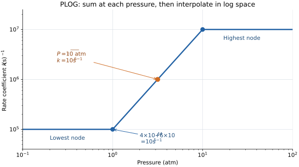

# PLOG rates and their derivatives

For an introduction in Japanese with the same worked example, see
[PLOGは圧力ごとの速度定数をつなぐ](guide-ja.md#plogは圧力ごとの速度定数をつなぐ).

PLOG represents a reaction's rate coefficient as a pressure-indexed set
of Arrhenius expressions. At a specified temperature, SpeedCHEM first
sums all expressions belonging to each pressure node, then interpolates
between node rates in logarithmic pressure and logarithmic rate.

The pressure entering this calculation is the current ideal-gas mixture
pressure. In the [constant-volume model](theory.md), it depends on both
temperature and composition. This dependence must also appear in the
analytical Jacobian.

## Contents

- [1. Input and meaning of a pressure node](#1-input-and-meaning-of-a-pressure-node)
- [2. Logarithmic interpolation](#2-logarithmic-interpolation)
- [3. Worked example](#3-worked-example)
- [4. Rate-coefficient derivatives](#4-rate-coefficient-derivatives)
- [5. The constant-volume Jacobian](#5-the-constant-volume-jacobian)
- [6. Implementation details and supported scope](#6-implementation-details-and-supported-scope)

## 1. Input and meaning of a pressure node

A CHEMKIN-style PLOG continuation line is

```text
PLOG / P_atm  A  b  E /
```

It belongs to the preceding reaction. `P_atm` is pressure in atmospheres;
the interpreter converts it using $1\;\mathrm{atm}=101325\;\mathrm{Pa}$.
`E` follows the activation-energy units selected in the `REACTIONS`
header and is converted to $E/R_u$ in kelvin. The pre-exponential factor
is converted consistently with the ordinary Arrhenius coefficient and
the mechanism's molar/molecular concentration convention.

For distinct pressures $P_1<\cdots<P_N$, let $m$ enumerate the terms at
pressure $P_j$. Define

$$
k_{jm}(T)=A_{jm}T^{b_{jm}}
\exp\left(-\frac{\epsilon_{jm}}{T}\right),
\qquad \epsilon_{jm}=\frac{E_{jm}}{R_u},
$$

$$
\boxed{K_j(T)=\sum_m k_{jm}(T)}.
$$

$K_j$ is the rate coefficient at that pressure node, not an equilibrium
constant. Multiple entries at one pressure are contributions to one
PLOG reaction. A `DUP` reaction instead represents an additional reaction
record whose progress rate is accumulated separately.

Summation precedes interpolation. In particular, $\ln K_j$ is the
logarithm of the sum of rates. It is not the sum or average of their
logarithms. Different $b$ and $E$ values also mean that adding the $A$
values alone does not generally produce an equivalent Arrhenius term.

PLOG parametrizes an effective rate coefficient $k(T,P)$, which can
represent pressure-dependent kinetics obtained from a separate kinetic
study. SpeedCHEM evaluates the supplied parametrization; it does not
solve a master equation to obtain the node coefficients. The pressure
table also carries no separate bath-gas composition dependence beyond
the mixture pressure used here.

## 2. Logarithmic interpolation

For $P_j\leq P<P_{j+1}$, define

$$
\theta=\frac{\ln(P/P_j)}{\ln(P_{j+1}/P_j)},
\qquad 0\leq\theta<1.
$$

The interpolated coefficient is

$$
\boxed{\ln k(T,P)
=(1-\theta)\ln K_j(T)+\theta\ln K_{j+1}(T)},
$$

or equivalently

$$
k(T,P)=K_j(T)^{1-\theta}K_{j+1}(T)^\theta.
$$

Rate logarithms denote numerical values in a consistent unit system;
equivalently one may take $\ln(k/k_*)$ with a common reference $k_*$.
Changing logarithm base does not change the interpolated coefficient.
The implementation uses natural logarithms and stores $\ln(P[\mathrm{Pa}])$.
Converting both the current pressure and the nodes consistently is
essential; the ratio form above makes the cancellation of units explicit.

For pressure outside the supplied range,

$$
k(T,P)=
\begin{cases}
K_1(T),&P<P_1,\\
K_N(T),&P\geq P_N.
\end{cases}
$$

A single distinct pressure node gives $k(T,P)=K_1(T)$ for all pressures.
Endpoint clamping continues the endpoint's temperature dependence; it
does not freeze the coefficient at one temperature or establish the
physical accuracy of extrapolation beyond the fitted pressure range.

These interpolation, summation, and endpoint rules agree with the
[PLOG semantics documented by Cantera](https://cantera.org/stable/reference/kinetics/rate-constants.html#pressure-dependent-arrhenius-rate-expressions-p-log).
The restrictions of this repository are given in
[Supported scope](#supported-scope).

## 3. Worked example

Consider the following illustrative continuation block for a hypothetical
first-order reaction. It uses constant terms ($b=E=0$), so the numerical
values are independent of temperature and have units s⁻¹:

```text
PLOG /  1.0  4.0E4  0.0  0.0 /
PLOG /  1.0  6.0E4  0.0  0.0 /
PLOG / 10.0  1.0E7  0.0  0.0 /
```

This is a schematic rate example, not a complete chemical mechanism.
The node sums are

$$
K_1=4\times10^4+6\times10^4=10^5\;\mathrm{s^{-1}},
\qquad K_2=10^7\;\mathrm{s^{-1}}.
$$

At $P=\sqrt{10}\;\mathrm{atm}$, the logarithmic fraction is $\theta=1/2$:

$$
k=\sqrt{K_1K_2}=10^6\;\mathrm{s^{-1}}.
$$

The midpoint is geometric in both pressure and rate. At 5.5 atm, which
is the arithmetic pressure midpoint, the coefficient is instead
$3.025\times10^6\;\mathrm{s^{-1}}$.



Both axes in the figure are logarithmic. The straight segment is the
PLOG interpolation; the flat segments use the nearest endpoint. The
two contributions at 1 atm form the single node shown at $10^5$ s⁻¹.

| Pressure (atm) | $\theta$ within the interval | $k$ (s⁻¹) |
| --- | --- | --- |
| 0.1 | Endpoint | $10^5$ |
| 1 | 0 | $10^5$ |
| $\sqrt{10}$ | 0.5 | $10^6$ |
| 5.5 | $\ln(5.5)/\ln(10)$ | $3.025\times10^6$ |
| 10 | Endpoint | $10^7$ |
| 100 | Endpoint | $10^7$ |

Inside this example's interval, $k=10^5(P/(1\;\mathrm{atm}))^2$.
Thus $\partial\ln k/\partial\ln P=2$. At fixed density and composition,
$P$ is proportional to $T$, so $dk/dT=2k/T$ while the state remains
inside the interval. At $T=1000$ K and $P=\sqrt{10}$ atm, that derivative
is $2000\;\mathrm{s^{-1}\,K^{-1}}$, despite every supplied Arrhenius
term having $b=E=0$. This is the pressure chain rule at work.

## 4. Rate-coefficient derivatives

### Temperature derivative at a node

For an individual Arrhenius term,

$$
g_{jm}=\frac{d\ln k_{jm}}{dT}
=\frac{b_{jm}}{T}+\frac{\epsilon_{jm}}{T^2}.
$$

The derivative of the summed node coefficient is

$$
g_j=\frac{d\ln K_j}{dT}
=\frac{\sum_m k_{jm}g_{jm}}{\sum_m k_{jm}}.
$$

It is a rate-weighted derivative, not an unweighted average of
Arrhenius parameters.

### Stable summation

The positive-$A$ implementation works in logarithms. With

$$
\ell_{jm}=\ln A_{jm}+b_{jm}\ln T-\frac{\epsilon_{jm}}{T},
\qquad L_j=\max_m\ell_{jm},
$$

it evaluates

$$
\ln K_j=L_j+\ln\sum_m\exp(\ell_{jm}-L_j),
$$

$$
g_j=\frac{\sum_m\exp(\ell_{jm}-L_j)g_{jm}}
{\sum_m\exp(\ell_{jm}-L_j)}.
$$

This log-sum-exp calculation avoids underflow of the individual node
rates before interpolation and scales the sum by its largest term.
The final conversion $k=\exp(\ln k)$ is still subject to floating-point
range limits. See `plog_group_lnk_dlnkdT` in
[SCmodule.f90](../src/SCmodule.f90).

### Pressure and temperature derivatives between nodes

Define the interval slope

$$
s=\left(\frac{\partial\ln k}{\partial\ln P}\right)_T
=\frac{\ln(K_{j+1}/K_j)}{\ln(P_{j+1}/P_j)}.
$$

Then

$$
\left(\frac{\partial k}{\partial P}\right)_T=\frac{k s}{P},
\qquad
\left(\frac{\partial\ln k}{\partial T}\right)_P
=(1-\theta)g_j+\theta g_{j+1}.
$$

The derivative at constant pressure is not the derivative needed for
the constant-volume reactor. With $P=\rho R_uTS$ and $S=\sum_iY_i/W_i$,

$$
\left(\frac{\partial\ln P}{\partial T}\right)_{\rho,\boldsymbol Y}
=\frac1T,
\qquad
\left(\frac{\partial\ln P}{\partial Y_l}\right)_{\rho,T}
=\frac{1/W_l}{S}.
$$

Consequently,

$$
\boxed{\left(\frac{\partial k}{\partial T}\right)_{\rho,\boldsymbol Y}
=k\left[(1-\theta)g_j+\theta g_{j+1}+\frac{s}{T}\right]},
$$

$$
\boxed{\left(\frac{\partial k}{\partial Y_l}\right)_{\rho,T}
=k s\frac{1/W_l}{S}}.
$$

`plog_kinf_eval` returns the first boxed expression in `dkinfdT`.
That output already includes $s/T$. Callers must not add that term
again. Its `dlnk_dlnP` output is $s$, indexed by the global reaction
number. Only entries belonging to PLOG reactions are overwritten.

### Knots and endpoints

The rate is continuous at pressure knots, but its pressure derivative
generally jumps. The implementation uses the interval to the right at
the lowest and interior nodes. At the highest node and above it,
it uses the endpoint branch with $s=0$. Below the lowest node,
and for a single distinct node, $s=0$ as well.

On an endpoint branch, $dk/dT=K_jg_j$. At an exact knot, the returned
Jacobian follows the branch convention; a two-sided derivative need
not exist. A centered finite difference that crosses a knot can therefore
disagree with that branch derivative even when the rate calculation is
correct. Similar care is needed when a temperature perturbation moves
the constant-volume state across a pressure knot.

## 5. The constant-volume Jacobian

### Forward and equilibrium-derived reverse rates

For a supported PLOG reaction, set

$$
a_r=\prod_iC_i^{\nu'_{ir}},
\qquad b_r=\prod_iC_i^{\nu''_{ir}},
\qquad q_{f,r}=k_r a_r,
\qquad q_{b,r}=\frac{k_r}{K_{c,r}}b_r.
$$

Both directions share the pressure-dependent $k_r$; $K_{c,r}$ depends
on temperature. For an irreversible reaction, take $q_{b,r}=0$ and
omit the reverse terms below. At fixed temperature,

$$
\boxed{\left(\frac{\partial q_r}{\partial\ln P}\right)_{T,\boldsymbol C}
=s_r(q_{f,r}-q_{b,r})=s_rq_r}.
$$

This partial derivative isolates the explicit pressure dependence of
the coefficient while holding the concentration products fixed. In
the reactor, the state perturbation also changes those products.

With all $Y_l$ treated as independent solver coordinates,

$$
\left(\frac{\partial q_r}{\partial Y_l}\right)_{\rho,T}
=\frac{\nu'_{lr}q_{f,r}-\nu''_{lr}q_{b,r}}{Y_l}
+q_rs_r\frac{1/W_l}{S}.
$$

The first term is the usual mass-action derivative at a positive state.
The second term is the PLOG pressure contribution. It can be nonzero
even for a species that does not participate in that reaction, because
that species still contributes to total pressure. These are
unconstrained state derivatives: renormalizing the mass fractions after
each perturbation would change the Jacobian being measured.

At fixed density and composition, the concentrations are independent of
temperature. Define

$$
G_r=\left(\frac{\partial\ln k_r}{\partial T}\right)_{\rho,\boldsymbol Y}.
$$

Then the progress-rate temperature derivative is

$$
\left(\frac{\partial q_r}{\partial T}\right)_{\rho,\boldsymbol Y}
=G_rq_r+q_{b,r}\frac{d\ln K_{c,r}}{dT}.
$$

For direct ideal-gas thermodynamics,

$$
\frac{d\ln K_{c,r}}{dT}
=\frac{\Delta_r\bar h^\circ}{R_uT^2}-\frac{\Delta\nu_r}{T}.
$$

Thus pressure coupling and the reverse equilibrium-temperature
derivative are separate contributions.

### Mapping to species and temperature derivatives

Let $B_{ir}=W_i\nu_{ir}/\rho$, so that
$\boldsymbol f_Y=B\boldsymbol q$. The PLOG-only addition to the
species composition block is

$$
\Delta(J_{YY})_{il}
=\sum_{r\in\mathrm{PLOG}}B_{ir}q_rs_r\frac{1/W_l}{S}.
$$

Define

$$
v_i=\sum_{r\in\mathrm{PLOG}}B_{ir}q_rs_r,
\qquad w_l=\frac{1/W_l}{S}.
$$

The pressure contribution has the outer-product form

$$
\boxed{\Delta J_{YY}=\boldsymbol v\boldsymbol w^{\mathsf T}}.
$$

It is a rank-at-most-one update at a given state. It has a column for
every species, but only rows whose species can be changed by a PLOG
reaction need to be added to the structural pattern. The total Jacobian
still contains the ordinary mass-action and other reaction contributions.

`constV_jac_sparse` accumulates `q * dlnk_dlnP` over PLOG reactions,
maps that vector to species, and applies this update to the union
pattern. It preserves the structural entries even if a particular
initial state has zero net rate or zero pressure slope; those values
can become nonzero later.

The temperature row is derived from the energy equation and the updated
species block. PLOG also enters the temperature column through
`dkinfdT`. The complete energy-row formulas are in
[Structure of the analytical Jacobian](theory.md#6-structure-of-the-analytical-jacobian).

## 6. Implementation details and supported scope

### Data and evaluation path

| Step | Location |
| --- | --- |
| Parse `PLOG / P A b E /`, convert pressure, collect entries | `plog_collect`, PLOG branch of `CKAUXL` in [chemkin_module.f90](../src/chemkin_module.f90) |
| Convert Arrhenius parameters to runtime units | `CPREAC` in [chemkin_module.f90](../src/chemkin_module.f90) |
| Read and validate the packed `cklink` section | [SCcklink.f90](../src/SCcklink.f90) |
| Group equal-pressure entries, log-sum-exp, interpolation, derivatives | `reacpar::plog_kinf_eval` and `plog_group_*` in [SCmodule.f90](../src/SCmodule.f90) |
| Insert current PLOG coefficients into species-rate evaluation | `kinetics_mod::SCdwdt` in [SCmodule.f90](../src/SCmodule.f90) |
| Recompute pressure and add the analytical derivative contributions | `constV_jac_sparse` in [SCconV.f90](../src/SCconV.f90) |
| Disable simplified sparsity when PLOG is present | `chemistry_input` in [chemistry_input.f90](../src/chemistry_input.f90) |

The packed runtime arrays are `plog_reaction`, `plog_node_ptr`,
`plog_logP`, `plog_A`, `plog_b`, and `plog_EoverR`. Their stored node
entries can include multiple terms at one distinct pressure. The
evaluator groups adjacent entries whose logarithmic pressures differ
from the group's first entry by at most $10^{-9}$.

For physical states, the RHS and Jacobian compute the pressure from the
same ideal-gas relation. The Jacobian callback recomputes it from its
own state, avoiding dependence on a previously cached RHS pressure.
The low-level rate evaluator falls back to the lowest node for a
nonpositive pressure; that guard does not define a physical reactor
state. The Jacobian rejects nonpositive temperature, density, or
recomputed pressure through its invalid-state guard.

### Supported scope

This public implementation requires:

- Positive pressure nodes in non-decreasing input order for each reaction.
  Equal pressures are allowed and grouped.
- A finite, strictly positive $A$ for every PLOG term. The binary loader
  also checks that the stored pressure logarithms, $b$, and $E/R_u$
  values are finite and that the packed topology is valid.
- Integer stoichiometry, with no `FORD/RORD` on a PLOG reaction.
- No explicit `REV`, third-body, or falloff syntax combined with PLOG.
  Equilibrium-derived reversibility is supported.

The positive-$A$ restriction is stronger than the general mathematical
requirement $K_j(T)>0$. For comparison,
[Cantera allows signed Arrhenius contributions provided their node sum is positive](https://cantera.org/stable/reference/kinetics/rate-constants.html#pressure-dependent-arrhenius-rate-expressions-p-log).
This repository rejects a negative $A$ even if a hypothetical node sum
would remain positive. Replacing a negative $A$ by its absolute value
changes the mechanism; it is not an equivalent input conversion.

PLOG is already an effective pressure-dependent rate form. Multiplying
it by an extra collider concentration, interpolating the Arrhenius
parameters themselves, or keeping pressure fixed when forming the
constant-volume Jacobian changes the equations derived above.

## References

- [Cantera: Pressure-dependent Arrhenius rate expressions (P-Log)](https://cantera.org/stable/reference/kinetics/rate-constants.html#pressure-dependent-arrhenius-rate-expressions-p-log)
  for interpolation, same-pressure summation, endpoint treatment, and
  the distinction between positive node sums and positive individual terms.
- [Governing equations and numerical solvers](theory.md) for reactor
  assumptions, unit conversions, equilibrium constants, and the
  original SpeedCHEM method references.

The examples and derivative formulas here explain the current source.
They do not establish the accuracy of any supplied mechanism, its
pressure fits, or a CFD calculation that embeds the library.
